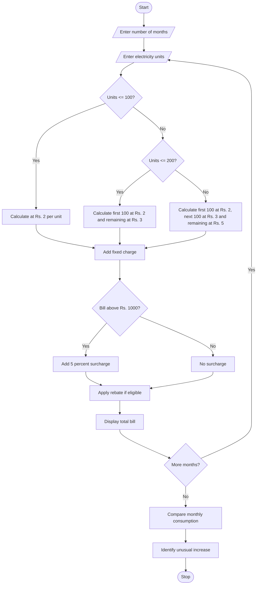

# Problem Statement
Develop a Python program to calculate household electricity bills based on multiple consumption slabs. The program should calculate electricity charges, fixed charges, surcharges, and rebates. It should also compare electricity bills across several months and identify unusual increases in consumption.
# Algorithm
1. Start the program.
2. Enter the number of months.
3. Enter the electricity units consumed for each month.
4. Calculate the bill using different consumption slabs.
5. Add fixed charges to the bill.
6. Calculate surcharge if applicable.
7. Apply rebate if applicable.
8. Display the total electricity bill.
9. Compare the current month's consumption with the previous month.
10. Identify unusual increases in consumption.
11. Display the monthly bill report.
12. Stop the program.
# Mermaid Flowchart

# Python Source Code

units_list = []
bills = []

n = int(input("Enter number of months: "))

for i in range(n):
    print("\nMonth", i + 1)
    units = int(input("Enter electricity units: "))

    if units <= 100:
        charge = units * 2

    elif units <= 200:
        charge = 100 * 2 + (units - 100) * 3

    else:
        charge = 100 * 2 + 100 * 3 + (units - 200) * 5

    bill = charge + 50

    if bill > 1000:
        bill = bill + bill * 0.05

    if units <= 100:
        bill = bill - bill * 0.05

    units_list.append(units)
    bills.append(bill)

print("\n--- ELECTRICITY BILL REPORT ---")

for i in range(n):
    print("\nMonth:", i + 1)
    print("Units:", units_list[i])
    print("Total Bill: Rs.", round(bills[i], 2))

print("\n--- CONSUMPTION COMPARISON ---")

for i in range(1, n):
    increase = ((units_list[i] - units_list[i-1])
                / units_list[i-1]) * 100

    print("Month", i + 1,
          "Increase:", round(increase, 2), "%")

    if increase > 20:
        print("Unusual Increase Detected")
    else:
        print("Normal Consumption")
  # Sample Input
 Enter number of months: 3

Month 1
Enter electricity units: 100

Month 2
Enter electricity units: 120

Month 3
Enter electricity units: 160
# Expected Output
--- ELECTRICITY BILL REPORT ---

Month: 1
Units: 100
Total Bill: Rs. 237.5

Month: 2
Units: 120
Total Bill: Rs. 290.0

Month: 3
Units: 160
Total Bill: Rs. 410.0

--- CONSUMPTION COMPARISON ---

Month 2 Increase: 20.0 %
Normal Consumption

Month 3 Increase: 33.33 %
Unusual Increase Detected
# screenshot

