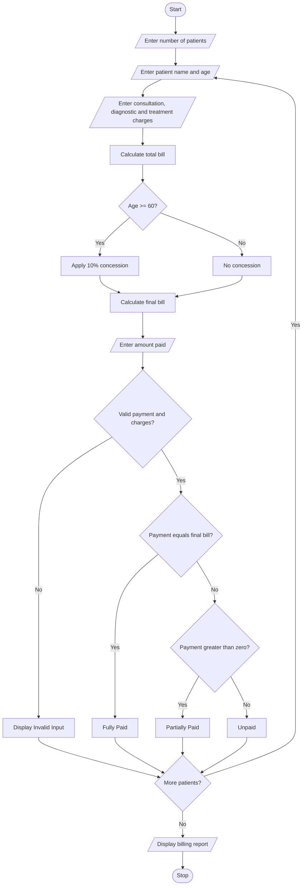

# Problem Statement
Develop a Python program to calculate hospital bills based on consultation charges, diagnostic charges, and treatment charges. Apply conditional concessions to eligible patients, validate billing constraints, calculate the final amount, and classify patients according to their payment status as Fully Paid, Partially Paid, or Unpaid.
# Algorithm
1. Start the program.
2. Enter the number of patients.
3. Enter the patient name and age.
4. Enter consultation, diagnostic, and treatment charges.
5. Calculate the total bill.
6. If the patient is 60 years or above, apply a 10% concession.
7. Calculate the final bill after concession.
8. Enter the amount paid by the patient.
9. Validate that charges and payment are not negative and payment does not exceed the final bill.
10. Classify the patient:
    - If payment equals the final bill, Fully Paid.
    - If payment is greater than zero, Partially Paid.
    - If payment is zero, Unpaid.
11. Display the patient bill and payment status.
12. Repeat for all patients.
13. Stop the program.
    # Mermaid Flowchart

  # Python Source Code
    
n = int(input("Enter number of patients: "))

for i in range(n):
    print("\nPatient", i + 1)

    name = input("Enter patient name: ")
    age = int(input("Enter age: "))

    consultation = float(input("Enter consultation charge: "))
    diagnostic = float(input("Enter diagnostic charge: "))
    treatment = float(input("Enter treatment charge: "))

    if (age < 0 or consultation < 0 or
        diagnostic < 0 or treatment < 0):
        print("Invalid Input")
        continue

    total = consultation + diagnostic + treatment

    if age >= 60:
        concession = total * 0.10
    else:
        concession = 0

    final_bill = total - concession

    print("Total Bill: Rs.", total)
    print("Concession: Rs.", concession)
    print("Final Bill: Rs.", final_bill)

    paid = float(input("Enter amount paid: "))

    if paid < 0 or paid > final_bill:
        print("Invalid Payment")
        continue

    balance = final_bill - paid

    if paid == final_bill:
        status = "Fully Paid"
    elif paid > 0:
        status = "Partially Paid"
    else:
        status = "Unpaid"

    print("\n--- PATIENT BILL ---")
    print("Patient Name:", name)
    print("Final Bill: Rs.", final_bill)
    print("Amount Paid: Rs.", paid)
    print("Balance: Rs.", balance)
    print("Patient Classification:", status)

print("\nHospital Billing Completed")

    R -- No --> S[/Display billing report/]
    S --> T([Stop])
# Sample Input
Enter number of patients: 3

Patient 1
Enter patient name: Ravi
Enter age: 65
Enter consultation charge: 500
Enter diagnostic charge: 1000
Enter treatment charge: 3000
Enter amount paid: 4050

Patient 2
Enter patient name: Kumar
Enter age: 35
Enter consultation charge: 500
Enter diagnostic charge: 500
Enter treatment charge: 2000
Enter amount paid: 1500

Patient 3
Enter patient name: Sita
Enter age: 22
Enter consultation charge: 300
Enter diagnostic charge: 200
Enter treatment charge: 1000
Enter amount paid: 0
# sample output
--- PATIENT BILL ---

Patient Name: Ravi
Final Bill: Rs. 4050.0
Amount Paid: Rs. 4050.0
Balance: Rs. 0.0
Patient Classification: Fully Paid

--- PATIENT BILL ---

Patient Name: Kumar
Final Bill: Rs. 3000.0
Amount Paid: Rs. 1500.0
Balance: Rs. 1500.0
Patient Classification: Partially Paid

--- PATIENT BILL ---

Patient Name: Sita
Final Bill: Rs. 1500.0
Amount Paid: Rs. 0.0
Balance: Rs. 1500.0
Patient Classification: Unpaid

Hospital Billing Completed
# Screen shot

