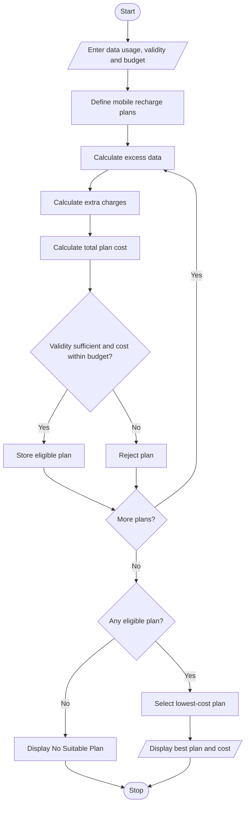

# Problem Statement
Develop a Python program to calculate employee salary based on basic pay, allowances, overtime, and incentives. Calculate the gross salary, apply progressive deductions, and generate a formatted salary statement showing total deductions and net salary.
# Algorithm
1. Start the program.
2. Enter employee name and basic salary.
3. Enter allowances, overtime hours, overtime rate, and incentives.
4. Calculate overtime payment.
5. Calculate gross salary.
6. Calculate progressive deductions based on salary slabs.
7. Calculate Provident Fund (PF) deduction.
8. Calculate total deductions.
9. Calculate net salary.
10. Display the formatted salary statement.
11. Stop the program.
 # Mermaid Flowchart

# Python Source Code

plans = [
    ("Basic", 199, 10, 28, 20),
    ("Standard", 299, 20, 28, 10),
    ("Premium", 399, 30, 56, 5)
]

usage = float(input("Enter required data usage (GB): "))
days = int(input("Enter required validity (days): "))
budget = float(input("Enter your budget: "))

eligible = []

print("\n--- MOBILE PLAN COMPARISON ---")

for name, price, data, validity, extra_rate in plans:

    extra = max(0, usage - data)
    extra_charge = extra * extra_rate
    total = price + extra_charge

    print("\nPlan:", name)
    print("Plan Price: Rs.", price)
    print("Extra Data: ", extra, "GB")
    print("Extra Charge: Rs.", extra_charge)
    print("Total Cost: Rs.", total)

    if validity >= days and total <= budget:
        eligible.append((name, total, validity))

if eligible:
    eligible.sort(key=lambda x: x[1])

    print("\n--- BEST MOBILE PLAN ---")
    print("Plan Name:", eligible[0][0])
    print("Total Cost: Rs.", eligible[0][1])
    print("Validity:", eligible[0][2], "days")
    print("Status: Most Economical Plan")

else:
    print("\nNo Suitable Plan Available")
# Sample Input
Enter required data usage (GB): 18
Enter required validity (days): 28
Enter your budget: 500
# Expected Output
--- MOBILE PLAN COMPARISON ---

Plan: Basic
Plan Price: Rs. 199
Extra Data: 8.0 GB
Extra Charge: Rs. 160.0
Total Cost: Rs. 359.0

Plan: Standard
Plan Price: Rs. 299
Extra Data: 0 GB
Extra Charge: Rs. 0
Total Cost: Rs. 299

Plan: Premium
Plan Price: Rs. 399
Extra Data: 0 GB
Extra Charge: Rs. 0
Total Cost: Rs. 399

--- BEST MOBILE PLAN ---

Plan Name: Standard
Total Cost: Rs. 299
Validity: 28 days
Status: Most Economical Plan
# screenshot

