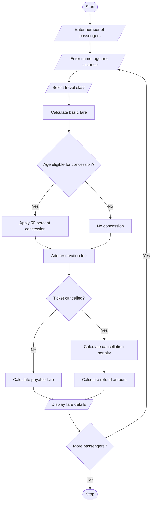

# Problem Statement
Develop a Python program to calculate railway ticket fares for multiple passengers based on travel distance, travel class, age-based concessions, and reservation fees. The program should also calculate cancellation penalties and display the final payable amount for each passenger.
# Algorithm
1. Start the program.
2. Enter the number of passengers.
3. Enter passenger name and age.
4. Enter travel distance in kilometres.
5. Select the travel class.
6. Calculate the basic fare based on distance.
7. Apply age-based concessions if eligible.
8. Add reservation charges.
9. Ask whether the ticket is cancelled.
10. If cancelled, calculate the cancellation penalty.
11. Calculate the final fare.
12. Display the passenger-wise fare details.
13. Repeat for all passengers.
14. Stop the program.
 # Mermaid Flowchart

# Python Source Code

n = int(input("Enter number of passengers: "))

for i in range(n):

    print("\nPassenger", i + 1)

    name = input("Enter passenger name: ")
    age = int(input("Enter age: "))
    distance = float(input("Enter distance in km: "))

    print("1. General")
    print("2. Sleeper")
    print("3. AC")

    choice = int(input("Select travel class: "))

    if age < 0 or distance <= 0:
        print("Invalid Input")
        continue

    if choice == 1:
        rate = 1
        reservation = 20
        travel_class = "General"

    elif choice == 2:
        rate = 1.5
        reservation = 40
        travel_class = "Sleeper"

    elif choice == 3:
        rate = 3
        reservation = 60
        travel_class = "AC"

    else:
        print("Invalid Class")
        continue

    basic_fare = distance * rate

    if age >= 60:
        concession = basic_fare * 0.50
    else:
        concession = 0

    final_fare = basic_fare - concession + reservation

    print("\nTicket Cancelled? (yes/no)")
    cancel = input("Enter choice: ").lower()

    print("\n--- RAILWAY FARE DETAILS ---")
    print("Passenger Name:", name)
    print("Age:", age)
    print("Travel Class:", travel_class)
    print("Basic Fare: Rs.", basic_fare)
    print("Concession: Rs.", concession)
    print("Reservation Fee: Rs.", reservation)
    print("Final Fare: Rs.", final_fare)

    if cancel == "yes":
        penalty = final_fare * 0.20
        refund = final_fare - penalty

        print("Cancellation Penalty: Rs.", penalty)
        print("Refund Amount: Rs.", refund)

    elif cancel == "no":
        print("Amount Payable: Rs.", final_fare)

    else:
        print("Invalid Cancellation Choice")

print("\nRailway Calculation Completed")
# Sample Input
Enter number of passengers: 2

Passenger 1
Enter passenger name: Lokesh
Enter age: 65
Enter distance in km: 500
1. General
2. Sleeper
3. AC
Select travel class: 2

Ticket Cancelled? (yes/no)
Enter choice: no

Passenger 2
Enter passenger name: Ravi
Enter age: 30
Enter distance in km: 300
1. General
2. Sleeper
3. AC
Select travel class: 3

Ticket Cancelled? (yes/no)
Enter choice: yes
# Expected Output
--- RAILWAY FARE DETAILS ---

Passenger Name: Lokesh
Age: 65
Travel Class: Sleeper
Basic Fare: Rs. 750.0
Concession: Rs. 375.0
Reservation Fee: Rs. 40
Final Fare: Rs. 415.0
Amount Payable: Rs. 415.0

--- RAILWAY FARE DETAILS ---

Passenger Name: Ravi
Age: 30
Travel Class: AC
Basic Fare: Rs. 900.0
Concession: Rs. 0
Reservation Fee: Rs. 60
Final Fare: Rs. 960.0
Cancellation Penalty: Rs. 192.0
Refund Amount: Rs. 768.0

Railway Calculation Completed
# screenshot

