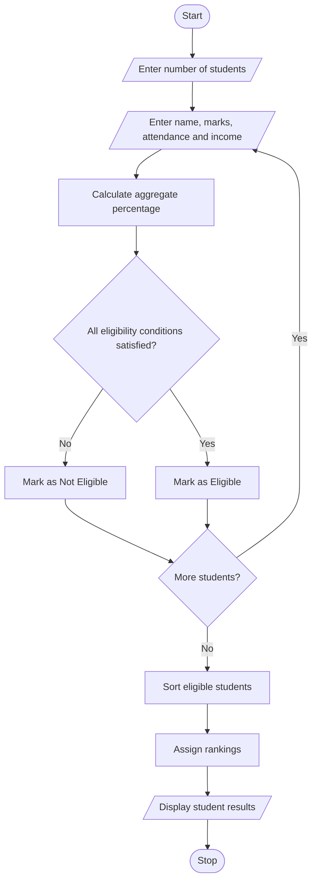

# Problem Statement
Design a Python program to allocate university scholarships to students based on the following criteria:
- Aggregate marks of students.
- Minimum marks in each subject.
- Student attendance percentage.
- Family annual income.
The program checks student eligibility, selects eligible students, ranks them according to their marks, and resolves ties using attendance and family income.
# Algorithm
1. Start the program.
2. Enter the number of students.
3. Read each student's name, subject marks, attendance, and family income.
4. Calculate the aggregate percentage.
5. Check the minimum subject marks.
6. Check aggregate marks, attendance, and income criteria.
7. If all conditions are satisfied, classify the student as eligible.
8. Store all eligible students in a list.
9. Sort eligible students based on aggregate marks, attendance, and family income.
10. Display the scholarship eligibility and ranking.
11. Stop the program.
  # Mermaid Flowchart

# Python Source Code

students = []
eligible = []

n = int(input("Enter number of students: "))

for i in range(n):
    print("\nStudent", i + 1)

    name = input("Enter student name: ")

    m1 = int(input("Enter subject 1 marks: "))
    m2 = int(input("Enter subject 2 marks: "))
    m3 = int(input("Enter subject 3 marks: "))

    attendance = float(input("Enter attendance: "))
    income = int(input("Enter family income: "))

    aggregate = (m1 + m2 + m3) / 3

    if (m1 >= 40 and m2 >= 40 and m3 >= 40
        and aggregate >= 75
        and attendance >= 75
        and income <= 250000):

        eligible.append(
            (name, aggregate, attendance, income)
        )

    else:
        students.append(name)

# Sort based on marks, attendance and income
eligible.sort(key=lambda x: (-x[1], -x[2], x[3]))

print("\n--- SCHOLARSHIP RESULTS ---")

for rank, student in enumerate(eligible, 1):
    print("\nRank:", rank)
    print("Name:", student[0])
    print("Aggregate:", round(student[1], 2), "%")
    print("Attendance:", student[2], "%")
    print("Family Income: Rs.", student[3])
    print("Status: Eligible")

print("\n--- NOT ELIGIBLE STUDENTS ---")

for name in students:
    print(name, "- Not Eligible")

print("\nTotal Eligible:", len(eligible))
print("Total Not Eligible:", len(students))
# Sample Input
Enter number of students: 4

Student 1
Enter student name: Asha
Enter subject 1 marks: 85
Enter subject 2 marks: 80
Enter subject 3 marks: 90
Enter attendance: 90
Enter family income: 200000

Student 2
Enter student name: Ravi
Enter subject 1 marks: 75
Enter subject 2 marks: 80
Enter subject 3 marks: 70
Enter attendance: 80
Enter family income: 220000

Student 3
Enter student name: Meena
Enter subject 1 marks: 90
Enter subject 2 marks: 35
Enter subject 3 marks: 95
Enter attendance: 85
Enter family income: 200000

Student 4
Enter student name: Kiran
Enter subject 1 marks: 80
Enter subject 2 marks: 85
Enter subject 3 marks: 90
Enter attendance: 857.
Enter family income: 240000
# Expected Output
--- SCHOLARSHIP RESULTS ---

Rank: 1
Name: Asha
Aggregate: 85.0 %
Attendance: 90.0 %
Family Income: Rs. 200000
Status: Eligible

Rank: 2
Name: Kiran
Aggregate: 85.0 %
Attendance: 85.0 %
Family Income: Rs. 240000
Status: Eligible

Rank: 3
Name: Ravi
Aggregate: 75.0 %
Attendance: 80.0 %
Family Income: Rs. 220000
Status: Eligible

--- NOT ELIGIBLE STUDENTS ---

Meena - Not Eligible

Total Eligible: 3
Total Not Eligible: 1
# screenshot

